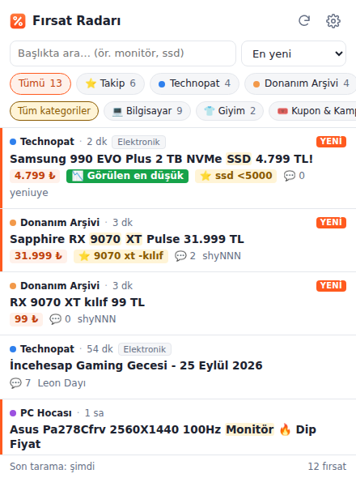
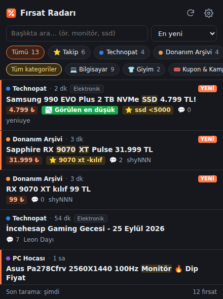

# Fırsat Radarı

[](https://github.com/Zerothlaw780/firsat-radari/actions/workflows/test.yml)

Technopat, Donanım Arşivi, R10, DonanımHaber ve PC Hocası'ndaki indirim konularını, istersen Telegram fırsat kanallarıyla birlikte, tek listede toplayan tarayıcı eklentisi. Takip listene uyan yeni bir fırsat açıldığında masaüstü bildirimi gönderir. Chrome, Edge, Brave ve Safari'de çalışır.

<p>
  
  
</p>

*(Ekran görüntüleri test verisiyle alındı.)*

## Özellikler

- **Kaynaklar:** Hazır olarak açık gelenler Technopat, Donanım Arşivi, R10, DonanımHaber Bilgisayar ve PC Hocası. Ayarlardan tek tıkla açılabilenler Technopat Oyun, ShiftDelete, DH Ev Elektroniği, DH Telefon ve iki Telegram kanalı (evEkonomisi ve Fırsat Merkezi). Telegram kanalları market, giyim ve ev ürünleri ağırlıklı; gönderilerinin çoğu satış ortaklığı (affiliate) bağlantısı, bu yüzden varsayılan olarak kapalı.
- **Tek liste:** Tüm kaynakların fırsatları tek yerde. Kaynağa göre süzme, arama, "en yeni / en çok yorum / en ucuz" sıralama.
- **Takip listesi ve bildirim:** `ssd <3000`, `9070 xt -kılıf` gibi kurallar yazarsın; yeni açılan bir konu uyarsa bildirim gelir.
- **Aynı fırsatı birleştirme:** Aynı ürün birkaç forumda paylaşıldıysa tek satırda görünür; diğer forumlardaki konular "Ayrıca:" satırında listelenir. Eşleştirme başlıktaki model koduna (`X24F182S`, `RX 9070 XT`, `Ryzen 5 5600`, `iPhone 16e` gibi), tarih yakınlığına ve fiyat uyumuna bakar.
- **Kategori filtresi:** Her fırsat başlığına göre Bilgisayar, Telefon & Tablet, Oyun, Ev & Elektronik, Market & Bakım, Giyim, Kupon & Kampanya ya da Diğer olarak sınıflanır. Popup'taki kategori çiplerinden seçtiklerin dışındakiler gizlenir; seçim kalıcıdır. Takip listesindeki kurallar kategori filtresinden bağımsız olarak bildirim göndermeye devam eder.
- **Satırdan hızlı işlemler:** Bir fırsatın üzerine gelince **Gizle** (o fırsatı tüm forumlardaki kopyalarıyla listeden kaldırır, geri alınabilir) ve **Takip et** (ürünün model kodunu ya da başlığın ilk kelimelerini takip listesine ekler) düğmeleri çıkar.
- **CSV dışa aktarma:** Ayarlar → Veri bölümünden toplanan fırsatlar ve fiyat geçmişi indirilebilir (Excel'de açılır; Python'da `pd.read_csv(dosya, sep=';', decimal=',')`). Fırsat dosyası, ileride popülerlik tahmini için kullanılabilecek ilk ve 24. saatteki yorum sayılarını da içerir.
- **Fiyat geçmişi:** Eklenti gördüğü fiyatları ürün bazında 6 ay saklar. Aynı model daha önce daha ucuza paylaşıldıysa "Daha önce 3.199 ₺", şimdiye kadarki en ucuz fiyatsa "📉 Görülen en düşük" rozeti çıkar. Geçmiş eklentinin kurulduğu günden itibaren birikir.
- **Fiyat okuma:** Başlıktaki fiyatı anlar ("3.369 TL", "999tl", "4.999₺", "1.796,52 TL"). "500 TL kupon", "2.000 TL'ye" gibi eşik ve indirim tutarlarını fiyat saymaz.
- **Gürültü filtresi:** Sabit konular, mağaza reklamları, "İndirim Bitti" / ❌ / [BİTTİ] konuları, eski konular ve DonanımHaber'deki dev "ana konu" başlıkları gizlenir.
- **Başka kaynak ekleme:** Herhangi bir XenForo veya vBulletin forum bölümü, DonanımHaber bölümü, herkese açık Telegram kanalı (`https://t.me/s/kanaladi`) ya da RSS/Atom akışı ayarlardan eklenebilir. Tür otomatik algılanır.
- **Gizlilik:** Sunucu yok. İstekler senin tarayıcından gider, her şey tarayıcının yerel depolamasında kalır.

## Kurulum

### Chrome / Edge / Brave

1. Repoyu klonla ya da GitHub'da **Code → Download ZIP** ile indir. Eklenti `extension/` klasöründe.
2. `chrome://extensions` sayfasını aç ve sağ üstten **Geliştirici modu**nu aç.
3. **Paketlenmemiş öğe yükle** deyip `extension/` klasörünü seç.

### Safari (Mac)

Safari eklentileri bir Mac uygulamasının içinde gelir. Bu uygulamayı Xcode'un dönüştürme aracı üretiyor.

1. App Store'dan **Xcode**'u kur ve bir kez aç.
2. Repo klasöründe çalıştır:
   ```bash
   ./scripts/safari.sh
   ```
   Bu komut `safari/` klasörüne bir Xcode projesi oluşturup açar.
3. Xcode'da üstteki şemadan **Firsat Radari (macOS)**'u seç ve **Run** (⌘R) de. Açılan küçük uygulama pencereyi kapatabilirsin.
4. Safari → Ayarlar → Gelişmiş → *Web geliştiricileri için özellikleri göster* (Show features for web developers) seçeneğini aç. Sonra Ayarlar → Geliştirici (Developer) sekmesinde *İmzasız uzantılara izin ver* (Allow unsigned extensions) seçeneğini işaretle. Eski Safari sürümlerinde bu seçenek Geliştir menüsünde.
5. Safari → Ayarlar → Uzantılar/Genişletmeler (Extensions) sekmesinde **Fırsat Radarı**'nı aç. Dört forum için web sitesi erişimine izin ver (Edit Websites → Allow). Eklenti sayfaları arka planda okuyabilmek için bu izne ihtiyaç duyuyor.

Safari'de bilinmesi gerekenler:

- "İmzasız uzantılara izin ver" Safari her kapandığında sıfırlanır. Xcode'da Signing & Capabilities bölümünden kendi Apple kimliğini (ücretsiz "Personal Team") seçip derlersen buna gerek kalmaz.
- Safari eklentilerde masaüstü bildirimini desteklemiyor. Takip eşleşmeleri listede ⭐ ile, yeni konu sayısı simgedeki rozetle görünür.
- Safari 16.4 veya üstü gerekir.

## Takip kuralları

| Kural | Anlamı |
|---|---|
| `monitör 27` | Başlıkta ikisi de geçmeli |
| `ssd <3000` | Fiyatı 3000 TL veya altı |
| `9070 xt -kılıf` | "kılıf" geçenler hariç |
| `ekran kartı <25k` | 25.000 TL veya altı |
| `# not` | Yorum satırı |

Türkçe karakterler fark etmez (`monitor` = `monitör`). Fiyatı başlıkta yazmayan konular fiyat şartlı kurallara uymaz. Bir kaynak ilk kez tarandığında mevcut konular listeye girer ama bildirim gönderilmez; bildirimler sonradan açılan konular için gelir.

## Nasıl çalışıyor

```
alarm (10 dk) → background.js → fetch (tarayıcının kendi çerezleriyle)
                     │
                     ├─ Chrome: offscreen.html içinde DOMParser   ┐
                     └─ Safari: arka plan sayfasında DOMParser    ┴→ lib/parsers.js
                                                                        │
             popup.js ← chrome.storage ← lib/core.js (birleştir, yeni olanları bul)
                                              └→ bildirim + rozet
```

- **Ayrıştırıcılar** (`lib/parsers.js`): XenForo 2 (`.structItem--thread`), vBulletin (`a[id^=thread_title_]`), DonanımHaber (`.kl-icerik-satir`), Telegram web önizlemesi (`.tgme_widget_message`) ve RSS/Atom. Seçiciler dört sitenin gerçek sayfalarında denendi.
- **Offscreen belge:** Chrome'un arka plan service worker'ında (sayfası olmayan arka plan betiği) DOM yok. HTML'i ayrıştırmak için görünmez bir sayfa açılıyor. Safari arka planı zaten DOM'u olan bir sayfa olarak çalıştırdığı için orada doğrudan ayrıştırılıyor.
- **Bot doğrulaması:** İstekler senin tarayıcından ve çerezlerinle gittiği için siteler seni normal bir ziyaretçi olarak görür. Bir site Cloudflare doğrulaması gösterirse listede uyarı çıkar; siteyi bir kez normal sekmede açmak yeterli.
- Tarama sıklığı en az 5 dakikadır. Bu sınır forumları yormamak için var.

## Geliştirme

```bash
npm test                      # birim testleri (fiyat okuma, filtreler, birleştirme)
npm install
npx playwright install chromium
npm run test:e2e              # eklentiyi Chromium'a yükleyip uçtan uca test eder
npm run package               # dist/ altına Chrome zip'i üretir
```

Uçtan uca test forum isteklerini örnek sayfalarla yanıtlıyor. Şu akışı doğruluyor: ilk tarama, yeni konu bildirimi, gizleme kuralları, arama, bot doğrulaması uyarısı, RSS algılama ve ayarların kaydedilmesi. Ekran görüntüleri `test-results/` klasörüne yazılır.

Bir site tasarımını değiştirip liste boş gelmeye başlarsa `extension/lib/parsers.js` içindeki ilgili fonksiyonun seçicilerini güncellemek genelde yeterli olur.

| Dosya | Görevi |
|---|---|
| `extension/manifest.json` | Eklenti tanımı ve izinler (Chrome + Safari) |
| `extension/background.js` | Periyodik tarama, bildirim, rozet |
| `extension/offscreen.*` | Chrome'da HTML ayrıştırma |
| `extension/lib/parsers.js` | Site ayrıştırıcıları |
| `extension/lib/filters.js` | Fiyat okuma, filtreler, takip kuralları |
| `extension/lib/core.js` | Varsayılan kaynaklar, sonuçları birleştirme |
| `extension/lib/products.js` | Model kodu çıkarma, aynı fırsatı gruplama, fiyat geçmişi, takip önerisi |
| `extension/lib/categories.js` | Başlıktan kategori tahmini |
| `extension/lib/export.js` | CSV dışa aktarma |
| `extension/lib/ext.js` | `chrome` / `browser` API farkını kapatır |
| `extension/popup.*`, `extension/options.*` | Arayüz |
| `scripts/safari.sh` | Safari için Xcode projesi üretir |
| `tests/` | Birim ve uçtan uca testler |

---

## English

**Fırsat Radarı** ("Deal Radar") is a browser extension that merges the hot-deals sections of Turkish tech forums (Technopat, Donanım Arşivi, R10, DonanımHaber) into one list. It filters out stickies, store ads and expired deals, reads prices from thread titles, and sends a desktop notification when a new deal matches your watch rules (e.g. `ssd <3000`). You can add any XenForo or vBulletin forum section or any RSS feed as a source. It works in Chrome/Edge/Brave (load `extension/` unpacked) and in Safari 16.4+ via `./scripts/safari.sh` (Safari has no desktop notifications for extensions). There is no server: requests go out from your own browser and all data stays in local extension storage.

## Lisans

[MIT](LICENSE)
